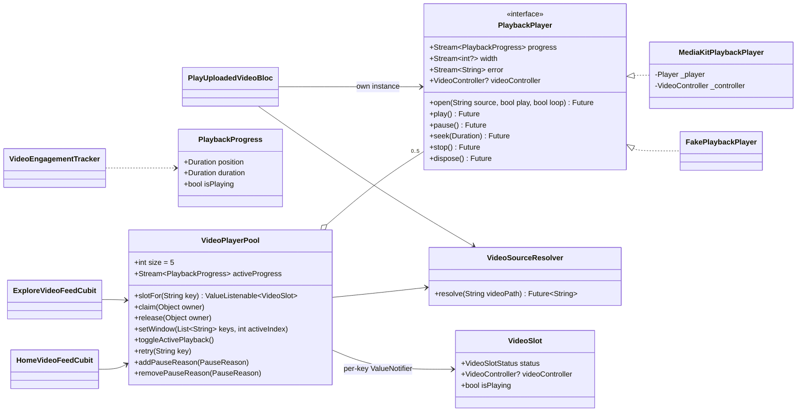

## feat: migrate video feeds to media_kit with a pooled player - Extensive

## Overview

Replace `video_player` with `media_kit` (libmpv) across the app. The Home and Explore vertical feeds share one app-scoped `VideoPlayerPool` holding at most 5 reusable players. Players are keyed by `videoPath`. A preload window keeps the next 2 videos and the previous 1 opened, paused on their first frame. New sources load into existing players with `open()`; players are never disposed while the app runs. The single-video screen (`play_uploaded_video`) uses one plain media_kit player. `VideoEngagementTracker` takes a player-agnostic `PlaybackProgress`. When the migration is done, `video_player` is removed.

The pattern follows VGV's diVine case study (https://verygood.ventures/blog/video-playback-flutter-feed/). It is adapted to media_kit, which can load a new source into an existing player, so eviction reuses the player instead of disposing it.

## Problem Statement

Each feed cubit keeps a `Map<int, VideoPlayerController>` keyed by page index. It creates and disposes a controller for every page and preloads only `index + 1` ([home_video_feed_cubit.dart:347-355](lib/screens/home/video_feed/state/home_video_feed_cubit.dart#L347-L355)). Consequences:

- **Loading spinner on most swipes.** Any page except `index + 1` initializes from cold, and the placeholder is a black box with a spinner ([home_video_feed_page.dart:509-530](lib/screens/home/video_feed/presentation/widgets/home_video_feed_page.dart#L509-L530)).
- **Black frames during fast flings**, because controllers are disposed while their pages are still on screen.
- **No lifecycle handling.** There is no `WidgetsBindingObserver` or `AppLifecycleListener` in the app, so nothing explicitly stops playback when the app is backgrounded.
- **A race in the Home cubit.** It has no `_isInactive` guard (Explore does, at [explore_video_feed_cubit.dart:113](lib/screens/explore/video_feed/explore_video_feed_cubit.dart#L113)), so an `initialize()` that finishes after the cubit closes can call `emit` on a closed cubit.
- **Audio under interstitial ads on iOS.** Presenting an ad doesn't background the app on iOS, so the video keeps playing and can count a view.

## Proposed Solution

### Decisions (brainstorm, research and user answers)

| # | Decision | Source |
|---|----------|--------|
| D1 | The pool is one app-scoped `VideoPlayerPool`, a plain Dart class registered in `get_it`. | Brainstorm |
| D2 | Pool size is **5**. The preload window is 4 (current, 2 ahead, 1 behind); the fifth slot keeps the `+2` buffer warm when the user swipes back and forth. Each player's demuxer cache is capped with `bufferSize: 8 MiB` (default 32 MiB), so the worst case is about 5 × 16 MiB. Validate on a low-end Android device with the profiling checklist. | Brainstorm lean + research §5 |
| D3 | **Preloaded players stay paused on their first frame** (`open(play: false)`). Only the current video plays. This keeps one decoder active, no wakelock on preloads, and no view or engagement signals from preloaded videos. | User (replaces the brainstorm's "playing at volume 0") |
| D4 | **Players are created once and never disposed** (the diVine "reusable players" pattern). Eviction loads a new source into the least recently used player with `open()`. When a feed closes, the pool calls `stop()`, which unloads the media and frees the decoder. This avoids media_kit's open Android release-mode crash after `Player.dispose()` (#1443, #1348) and the UI-thread blocking in `dispose()` (#700). | User ("follow diVine") + research §6 |
| D5 | The pool key is the canonical `SportVideo.videoPath`. URL resolution happens inside the pool through an injected `resolveSource`. | Brainstorm |
| D6 | Feeds never coexist on the stack: each is pushed from its own tab, and creator-profile only pushes `play-video`. The "owner" model is therefore `claim(owner)` / `release(owner)` plus a **covered** pause reason. Only a pushed `PageRoute` covers a feed; a `RouteObserver<PageRoute<dynamic>>` ignores bottom sheets, which are `PopupRoute`s. The owner check stays even though feeds don't coexist: if feed A is popped and feed B is pushed quickly, A's `close()` can run after B's `initialize()`, and the check stops A's late `release` from stopping B's players. | Flow analysis, verified in the router |
| D7 | Playback is gated by `Set<PauseReason>` = `{background, covered, ad}` plus a `userPaused` flag for the active video. The active player plays only when the set is empty and the user hasn't paused it. On foreground the pool doesn't force-resume; removing `background` from the set lets the normal check decide what plays. There is no separate foreground flag: after each `await`, `reasons.contains(background)` serves that purpose. | Brainstorm + flow analysis + simplicity review |
| D8 | **Pause during interstitial ads.** The `onAdShowedFullScreenContent` callback adds the `ad` reason; the dismiss and failed-to-show callbacks remove it. This applies to both feeds. | User |
| D9 | Placeholders show `SportVideo.thumbnailUrl` until the slot's first frame is ready. When `thumbnailUrl` is null or fails to load, the page shows the existing black placeholder. A spinner appears only on the **current** page while its slot is `loading` (a cold start, or a page reached before its preload finished); a warm slot is already `ready`, so no spinner shows. | Brainstorm open question; default chosen |
| D9a | `VideoSlotStatus` has three values: `{loading, ready, error}`. An evicted or unassigned key's slot is `loading` with a null `videoController`, so the thumbnail shows. | Simplicity review |
| D10 | The "first frame ready" signal is `player.width` becoming greater than 0 after the latest `open()`, checked against a per-player request token. `VideoController.waitUntilFirstFrameRendered` completes only once per controller, so it is useless for a reused player. `ready` only controls removing the thumbnail; playback starts when `open()` completes. Phase 1's device check confirms that a paused `open()` emits `width`. | Research §3 + refine pass |
| D11 | Players keep media_kit's default `hwdec` (iOS `auto`, which resolves to VideoToolbox; Android `auto-safe`, which resolves to MediaCodec). Debug builds log mpv's `hwdec-current` after the first frame so it can be confirmed per platform. | Research §4 |
| D12 | Swiping back to a video restarts it at 0 and autoplays it, which matches today's behavior because `index - 1` is disposed now. Activating a video clears `userPaused`. | Flow analysis |
| D13 | A disk cache, HEVC transcoding, audio-session interruption handling (calls), and memory-pressure shrinking are out of scope. | Brainstorm + flow analysis |

### What the user sees

- Swiping to a preloaded video shows its first frame immediately and starts playing; there is no spinner.
- During a fast fling, every page shows either a thumbnail or a video frame, never an empty or black texture, and never the previous video's last frame.
- Backgrounding the app, opening a creator profile, or showing an interstitial ad pauses the video. Returning resumes it, unless the user had paused it.
- Retry, error, chrome toggle, rating, report, and creator-profile behavior are unchanged.

## Technical Approach

### Architecture



#### New files

| File | Purpose |
|------|---------|
| `lib/models/playback_progress.dart` | `PlaybackProgress` (Equatable): `position`, `duration`, `isPlaying`. Imports no player package. |
| `lib/services/video_playback/playback_player.dart` | The `PlaybackPlayer` interface. |
| `lib/services/video_playback/media_kit_playback_player.dart` | Production implementation that wraps `Player` and `VideoController`. |
| `lib/services/video_playback/video_slot.dart` | `VideoSlot`: immutable, `Equatable`, with `copyWith`. `ValueNotifier` only notifies when the new value is `!=` the old one. Also `VideoSlotStatus { loading, ready, error }`. |
| `lib/services/video_playback/video_source_resolver.dart` | `VideoSourceResolver(SupabaseService)`. `resolve(videoPath)`: an `http(s)` URL is returned unchanged; an existing local `File` path is returned as a path; anything else goes through `resolveVideoPlaybackUrl`. This is the single home for the rule now duplicated in Explore and `PlayUploadedVideoBloc`. |
| `lib/services/video_playback/video_player_pool.dart` | The pool: LRU, preload window, pause reasons. |
| `lib/widgets/pooled_video_surface.dart` | Shared surface used by both feeds: thumbnail or placeholder, `Video`, and the cold-start spinner. Also the pure function `videoErrorOverlayMessage(...)` (see Screens and pages). |
| `test/helpers/fake_playback_player.dart` | Fake player with controllable `StreamController`s and recorded calls (`openedSources`, `isPlaying`, `isLoaded`, `isDisposed`). It has **no static counters**: tests count instances through the `createPlayer` closure (`final created = <FakePlaybackPlayer>[]`). |
| `docs/video_playback_profiling.md` | Profiling checklist: Xcode Energy, Android Studio Profiler, `hwdec-current`. |

#### `PlaybackPlayer` (`lib/services/video_playback/playback_player.dart`)

```dart
/// Thin seam over the native player so pool and bloc logic run in `flutter test`.
///
/// Not fully player-agnostic: [videoController] exposes media_kit_video's
/// `VideoController` so widgets can render `Video`. The seam exists for
/// testability, not to make the player swappable.
abstract interface class PlaybackPlayer {
  /// [loop] maps to `PlaylistMode.single` / `PlaylistMode.none`.
  Future<void> open(String source, {required bool play, required bool loop});
  Future<void> play();
  Future<void> pause();
  Future<void> seek(Duration position);
  Future<void> stop(); // unloads media, frees the decoder, keeps the instance
  Future<void> dispose();

  Stream<PlaybackProgress> get progress; // combines position, duration, playing
  Stream<int?> get width; // first-frame signal (D10)
  Stream<String> get error;

  /// Null in tests; widgets fall back to the thumbnail.
  VideoController? get videoController;
}
```

The pool also needs to know whether a player is past position 0 (D12). The pool caches the last `PlaybackProgress` per player from `progress`, so the interface has no `currentProgress` getter. The bloc screen uses `StreamBuilder(initialData: PlaybackProgress.zero)`.

`MediaKitPlaybackPlayer` (`lib/services/video_playback/media_kit_playback_player.dart`):

- Builds `Player(configuration: PlayerConfiguration(bufferSize: 8 * 1024 * 1024))` and `VideoController(player)` with default hwdec (D11).
- `progress` merges `player.stream.position`, `duration` and `playing` into `PlaybackProgress`.
- In `kDebugMode`, after the first frame, it logs `(player.platform as NativePlayer).getProperty('hwdec-current')`. This is the only way to complete the manual "hwdec confirmed per platform" check, so it stays.
- `dispose()` guards against a double dispose, because media_kit asserts on it.

#### `VideoPlayerPool` (`lib/services/video_playback/video_player_pool.dart`)

```dart
enum PauseReason { background, covered, ad }

class VideoPlayerPool {
  VideoPlayerPool({
    required PlaybackPlayer Function() createPlayer,
    required Future<String> Function(String videoPath) resolveSource,
    this.size = 5,
  });
  // ...
}
```

How `setWindow({required List<String> keys, required int activeIndex})` behaves. The cubits pass the feed's `videoPath` list and the current index; the pool owns the window shape, so the cubits don't duplicate it:

1. It is **synchronous** for all bookkeeping and never awaited by callers. That makes fast flings safe: each call supersedes the previous one.
2. `wanted = [keys[i], keys[i + 1], keys[i + 2], keys[i - 1]]` in priority order, where `i` is `activeIndex`. Out-of-range indexes, empty keys and duplicates are dropped, and the list is capped at `size`.
3. For each wanted key that isn't bound to a player:
   - Take an unbound player, creating one if fewer than `size` exist.
   - Otherwise take the **least recently used** bound player whose key is not in `wanted`.
   - **Evict synchronously:** set the old key's slot to `VideoSlot.loading()` (null controller, so the thumbnail appears) *before* touching the player, and increment the player's request token.
   - Then, asynchronously: `resolveSource(key)` → `open(source, play: false, loop: true)` → wait for `width > 0` → set the slot to `ready` with the player's `videoController`. After every `await`, check the token, the owner and `reasons.contains(background)`; on a mismatch, drop the result.
   - An exception or `error` stream event marks the slot as `error`.
4. Touch the LRU order for every wanted key, with the active key touched last.
5. Call `_syncPlayback()`.
   - If the active key changed: clear `userPaused`, and if the player's last cached position is greater than 0, `seek(Duration.zero)` (D12).
   - The active player plays when `owner != null`, the reason set is empty, `!userPaused`, and its `open()` has completed for the current token. Every other player pauses. Playback does **not** wait for `ready`: `ready` (D10) only removes the thumbnail. A platform that emits `width` only once playback starts therefore can't stall the feed. `_syncPlayback()` runs again when an `open()` completes.
   - Update `VideoSlot.isPlaying` on the active slot from `progress`. This fires only when play state changes, so it doesn't add churn. It stays in the slot rather than cubit state so that toggling play doesn't rebuild the `PageView`.
6. `activeProgress` forwards progress only from the active player. This is the only progress feed the cubits use.

Other methods:

- **`slotFor(key)`** returns a lazily created notifier from a `Map<String, ValueNotifier<VideoSlot>>`. The map is cleared only by `release`. Two pages with the same `videoPath` share one slot, and so one texture; Flutter can show the same texture in two widgets, so this needs no special handling.
- **`release(owner)`** ignores the call unless `owner` is the current owner (D6). Otherwise it stops every player, clears the key bindings, the notifier map and the `covered` and `ad` reasons, and sets the owner to null. Players are **not** disposed (D4).
- **`claim(owner)`** releases any previous owner first.
- **`addPauseReason(reason)`** pauses every player at once. **`removePauseReason(reason)`** calls `_syncPlayback()`. Lifecycle is just the `background` reason (D7).
- **`retry(key)`** increments the player's token and runs the open sequence again for that key.

#### Registration and initialization

- `lib/main.dart`:
  - Call `MediaKit.ensureInitialized()` right after `WidgetsFlutterBinding.ensureInitialized()`.
  - In `_MyAppState.initState`, create `AppLifecycleListener(onHide: () => pool.addPauseReason(PauseReason.background), onShow: () => pool.removePauseReason(PauseReason.background))`; dispose it in `_MyAppState.dispose`. `onHide` fires on both platforms before `paused`.
- `lib/service_locator.dart` (registrations only, no logic):
  - `locator.registerFactory<PlaybackPlayer>(MediaKitPlaybackPlayer.new)`
  - `locator.registerSingleton<VideoSourceResolver>(VideoSourceResolver(supabaseService: locator<SupabaseService>()))`
  - `locator.registerSingleton<VideoPlayerPool>(VideoPlayerPool(createPlayer: locator<PlaybackPlayer>, resolveSource: locator<VideoSourceResolver>().resolve))`
  - `locator.registerSingleton<RouteObserver<PageRoute<dynamic>>>(RouteObserver<PageRoute<dynamic>>())`. Registering it in the locator, not as a global, lets screen tests use it without building `AppRouter`.
- `lib/routes/app_router.dart`: pass `observers: [locator<RouteObserver<PageRoute<dynamic>>>()]` to the root `GoRouter`. Feeds, `creator-profile`, `play-video` and `auth` are all root-level `PageRoute`s, created by `CustomTransitionPage`.

#### Feed cubits (`home_video_feed_cubit.dart`, `explore_video_feed_cubit.dart`)

- **Remove:** `_controllers`, `_controllerInitializers`, `_controllerListeners`, `controllerFor`, `_ensureController`, `_initializeController`, `_disposeStaleControllers`, `_disposeControllerAt`, `_pauseAllExcept`, `_attach/_detachViewTrackingListener`, `_bumpControllerGeneration`, and the `controllerGeneration` state field (in `home_video_feed_state.dart` and `explore_video_feed_state.dart`).
- **Add:**
  - `final VideoPlayerPool _pool = locator<VideoPlayerPool>()`, plus `StreamSubscription<PlaybackProgress>? _progressSubscription`.
  - `initialize()`: `_pool.claim(this)`, subscribe to `_pool.activeProgress`, then `_activateIndex`.
  - `_activateIndex(index)`: call `_pool.setWindow(keys: state.videos.map((v) => v.videoPath).toList(), activeIndex: index)`, which is synchronous, and reset `_viewThresholdReached`.
  - When the active `videoPath` is empty, emit `'This video is unavailable.'`, as today.
  - After `_loadMoreIfNeeded` appends videos, call `_activateIndex(state.currentIndex)` again to fill the preload window.
  - `ValueListenable<VideoSlot> slotFor(int index) => _pool.slotFor(state.videos[index].videoPath)`.
  - `togglePlayback(index)`: if `index == currentIndex`, call `_pool.toggleActivePlayback()`.
  - `retryActiveVideo()`: `_pool.retry(currentPath)`. It stays on the cubit so the UI never talks to the service directly.
  - `onRouteCovered()` / `onRouteUncovered()` and `onAdShown()` / `onAdClosed()` forward to `_pool.addPauseReason` / `removePauseReason` with `PauseReason.covered` and `PauseReason.ad`. Paired methods replace positional bool setters.
- **View tracking:** `_onProgress(PlaybackProgress p)` keeps today's logic: the tracker's `onPlaybackProgress`, the 600 ms replay reset and the 8 s view threshold. It is driven only by `activeProgress`, so preloaded videos can't count (D3).
- **`close()`:** cancel the subscription, then `_pool.release(this)`, `_engagementTracker.stop()`, `super.close()`. Nothing in the pool emits on the cubit, which removes the Home race.

#### Screens and pages

- **Cubit ownership moves to the screen state.** Both screens create the cubit in `initState` (`_cubit = HomeVideoFeedCubit(...)..initialize()`), provide it with `BlocProvider.value(value: _cubit)`, and call `_cubit.close()` in `dispose`. The ad callbacks and `RouteAware` live in the screen `State`, above where the provider sits today, and now use `_cubit` directly with no `GlobalKey`.
- Both feed screens `with RouteAware`.
  - In `didChangeDependencies`, `locator<RouteObserver<PageRoute<dynamic>>>().subscribe(this, ModalRoute.of(context)! as PageRoute)`; unsubscribe in `dispose`.
  - `didPushNext` calls `_cubit.onRouteCovered()`; `didPopNext` calls `_cubit.onRouteUncovered()`.
- Interstitial ads in both screens' `FullScreenContentCallback` (D8):
  - `onAdShowedFullScreenContent` → `_cubit.onAdShown()`
  - `onAdDismissedFullScreenContent` and `onAdFailedToShowFullScreenContent` → `_cubit.onAdClosed()`
- `HomeVideoFeedPage.controller` and Explore's `_VideoFeedPage.controller` become `ValueListenable<VideoSlot> slot`. A `ValueListenableBuilder<VideoSlot>` drives both:
  - `PooledVideoSurface(slot, thumbnailUrl, showLoadingIndicator: isCurrentVideo)`
  - the play/pause toggle, from `slot.isPlaying`
  - the error/retry overlay
- The error/retry overlay uses the pure function `String? videoErrorOverlayMessage({required VideoSlot slot, required String? errorMessage, required bool isCurrentVideo})` in `pooled_video_surface.dart`, which is unit-tested for every branch.
  - It returns null unless `isCurrentVideo && slot.status != ready && (slot.status == error || errorMessage != null)`.
  - For a slot error it returns `'Failed to load video. Tap to retry.'`; otherwise `errorMessage`.
  - This keeps today's rule that the overlay appears only when no video is showing.
- `lib/widgets/pooled_video_surface.dart` builds a `Stack`, bottom layer first:
  1. If `videoController != null`: `Video(controller, fit: BoxFit.cover, controls: NoVideoControls, pauseUponEnteringBackgroundMode: false)`.
  2. If `status != ready`: the thumbnail (`Image.network(thumbnailUrl, fit: cover, errorBuilder: → _VideoPlaceholder)`), or the black placeholder when the URL is null. This hides any stale frame from the previous source.
  3. If `showLoadingIndicator && status == loading`: a centered spinner.

#### Single-video screen (`lib/screens/play_uploaded_video.dart/`)

- `PlayUploadedVideoBloc` holds `PlaybackPlayer? _player`, created from `locator<PlaybackPlayer>()`.
- Initialize: `locator<VideoSourceResolver>().resolve(videoPath)`, then `open(source, play: false, loop: false)`. Wait for the first `progress` event with `duration > Duration.zero`, then emit `PlayUploadedVideoReady`.
- Play, pause and seek map directly onto the player.
- Override `close()` to dispose the player. Keep `DisposeVideoEvent`, but make it idempotent.
- The getter becomes `PlaybackPlayer? get player`.
- `play_uploaded_video_screen.dart` changes:
  - `VideoPlayer(controller)` and its `FittedBox` sizing become `Video(controller: player.videoController!, fit: BoxFit.cover, controls: NoVideoControls)`.
  - The slider and time label change from `ValueListenableBuilder<VideoPlayerValue>` to `StreamBuilder<PlaybackProgress>(stream: player.progress, initialData: PlaybackProgress.zero)`.
  - `seekTo` becomes `bloc.add(SeekVideoEvent(...))`.

#### `VideoEngagementTracker`

- `onPlaybackProgress(VideoPlayerValue)` becomes `onPlaybackProgress(PlaybackProgress)` and the `isInitialized` check is dropped. The progress type is only emitted for loaded media.
- Remove the `package:video_player` import.
- In the test, the `playing()` helper returns `PlaybackProgress`.
- In Phase 1 the cubits still use `video_player`, so they adapt with a one-line `PlaybackProgress(position: v.position, duration: v.duration, isPlaying: v.isPlaying)`. Phase 2 deletes this adapter.

#### Test setup (matches [home_bloc_test.dart](test/bloc/home_bloc_test.dart))

- **Pool tests** build `VideoPlayerPool` directly:
  - `createPlayer: () { final p = FakePlaybackPlayer(); created.add(p); return p; }`
  - `resolveSource: (k) async => 'https://cdn/$k'`
  - Tests drive `width`, `error` and `progress` through the fake's `StreamController`s. No `GetIt` is involved.
- **Cubit tests** use mocktail:
  - Register `MockVideoPlayerPool` in `GetIt.instance` next to the existing service mocks (`HomeFeedService`, `PreferencesService`, `SupabaseService`, `HomeVideoFeedSessionStore` / `ExploreFeedProgressStore`).
  - `registerFallbackValue(PauseReason.ad)`; stub `activeProgress` with a `StreamController<PlaybackProgress>`; call `GetIt.instance.reset()` in `tearDown`.
- **Screen test (Home only, since Explore uses the same code path):**
  - Register a real `RouteObserver<PageRoute<dynamic>>` and `MockVideoPlayerPool`, plus mocks for `AdMobConsentService` (`canRequestAds: false`) and `AuthService`.
  - Pump `HomeVideoFeedScreen` in a `MaterialApp(navigatorObservers: [observer])`.
  - Push a `MaterialPageRoute`, then verify `addPauseReason(PauseReason.covered)`; pop, then verify `removePauseReason(PauseReason.covered)`.
  - Show a modal bottom sheet and verify that no covered call is made.
- **Bloc test:** `test/screens/play_uploaded_video/`. The lib folder is literally named `play_uploaded_video.dart/`; a test directory ending in `.dart` would confuse `flutter test <path>`, so the test path deliberately drops the suffix.

## Implementation Phases

### Phase 1: Pool foundation

- **Status:** Done (automated validation green; the manual device check (a)–(c) is still pending and gates Phase 2)
- **Scope:** Add media_kit, the `PlaybackPlayer` seam, `VideoSourceResolver`, `VideoPlayerPool`, the lifecycle listener, `PlaybackProgress` and the tracker migration, plus pool, resolver and leak tests. App behavior is unchanged; the pool is registered but no feed uses it yet.
- **Files touched:**
  - `pubspec.yaml`: add `media_kit: ^1.2.6`, `media_kit_video: ^2.0.1`, `media_kit_libs_video: ^1.0.7`
  - `pubspec.lock`
  - `lib/main.dart`: `MediaKit.ensureInitialized()`, plus the `AppLifecycleListener` in `_MyAppState`
  - `lib/service_locator.dart`
  - `lib/models/playback_progress.dart`, `lib/services/video_playback/*.dart`
  - `lib/services/video_engagement_tracker.dart`
  - `lib/screens/home/video_feed/state/home_video_feed_cubit.dart` and `lib/screens/explore/video_feed/explore_video_feed_cubit.dart` (adapter line only)
  - `test/helpers/fake_playback_player.dart`
  - `test/services/video_playback/video_player_pool_test.dart`, `test/services/video_playback/video_player_pool_leak_test.dart`, `test/services/video_playback/video_source_resolver_test.dart`
  - `test/services/video_engagement_tracker_test.dart`
- **Acceptance criteria:**
  - The pool, resolver and leak tests pass; the tracker tests pass using `PlaybackProgress`; and the app builds and runs on iOS and Android with media_kit initialized.
  - **Device check of media_kit assumptions (throwaway code, not committed)** on one iOS and one Android device, using a `MediaKitPlaybackPlayer` in a temporary screen. Confirm:
    - (a) `open(play: false)` emits `width > 0` and shows the first frame while paused;
    - (b) calling `open()` on a reused player with a new source does or doesn't show the previous video's last frame before the new one;
    - (c) `stop()` followed by `open()` works on the same instance.
  - Record the results in the Phase 1 PR description. **If (a) fails on either platform, stop and revisit D3/D10 before starting Phase 2.**
- **Validation:** `flutter test test/services/video_playback test/services/video_engagement_tracker_test.dart`, plus the manual device check above.

### Phase 2: Wire the feeds to the pool

- **Status:** Done (automated validation green; the manual device checks for instant swipes, black/stale frames and background/covered/ad pause are still pending for the PR description)
- **Scope:** Move both feed cubits, pages and screens onto the pool. Add thumbnail placeholders through `PooledVideoSurface`, the `RouteObserver` covered handling, and ad pause and resume.
- **Files touched:**
  - `lib/service_locator.dart` (`RouteObserver` registration), `lib/routes/app_router.dart`, `lib/widgets/pooled_video_surface.dart`
  - Home feed: `lib/screens/home/video_feed/state/home_video_feed_cubit.dart`, `lib/screens/home/video_feed/state/home_video_feed_state.dart`, `lib/screens/home/video_feed/presentation/home_video_feed_screen.dart`, `lib/screens/home/video_feed/presentation/widgets/home_video_feed_page.dart`
  - Explore feed: `lib/screens/explore/video_feed/explore_video_feed_cubit.dart`, `lib/screens/explore/video_feed/explore_video_feed_state.dart`, `lib/screens/explore/video_feed/explore_video_feed_screen.dart`
  - Tests: `test/screens/home/video_feed/home_video_feed_cubit_test.dart`, `test/screens/home/video_feed/home_video_feed_screen_test.dart`, `test/screens/explore/video_feed/explore_video_feed_cubit_test.dart`, `test/widgets/pooled_video_surface_test.dart`
- **Acceptance criteria:**
  - No `package:video_player` import remains in the feed files.
  - The cubit tests cover: the `setWindow` call, that only active progress counts views, ad and covered pause reasons, the empty `videoPath` message, `retryActiveVideo`, load-more calling `setWindow` again, and release on close.
  - The screen test proves that a `PageRoute` push and pop toggles `covered`, and a bottom sheet does not.
  - The surface test proves that every `VideoSlotStatus` renders a thumbnail, the placeholder or a `Video`, and covers each `videoErrorOverlayMessage` branch.
  - **The PR description includes the manual device checks** from the Success Criteria (instant swipes, no black or stale frames, background/covered/ad pause), with results.
- **Validation:** `flutter test test/screens/home/video_feed test/screens/explore/video_feed test/widgets/pooled_video_surface_test.dart && ! grep -rq "package:video_player/" lib/screens/home lib/screens/explore`

### Phase 3: Single-video screen, dependency removal and profiling

- **Status:** Done (automated validation green; the Android release-build dispose check and the profiling checklist are still pending on device)
- **Scope:** Migrate `play_uploaded_video` to `PlaybackPlayer`, remove `video_player`, and add the profiling checklist doc.
- **Files touched:**
  - `lib/screens/play_uploaded_video.dart/bloc/play_uploaded_video_bloc.dart`, `lib/screens/play_uploaded_video.dart/play_uploaded_video_screen.dart`
  - `test/screens/play_uploaded_video/play_uploaded_video_bloc_test.dart`
  - `pubspec.yaml`, `pubspec.lock`
  - `docs/video_playback_profiling.md`
- **Acceptance criteria:**
  - The bloc test proves the player is disposed on `close()`, and that 20 open/close cycles leave every player in the factory closure's `created` list with `isDisposed == true`.
  - `video_player` is absent from `pubspec.yaml`, `pubspec.lock` and every import.
  - `docs/video_playback_profiling.md` exists.
  - **The PR description has its own line for the Android release-build dispose check:** open and close `play-video` 10 times on a release build with no crash (#1443).
  - Running the profiling checklist on devices is a **pre-release gate, not a merge blocker**.
- **Validation:** `flutter test && ! grep -rqE "package:video_player/|^\s+video_player:" pubspec.yaml pubspec.lock lib test`

## Alternative Approaches Considered

- **One pool per feed cubit:** rejected in the brainstorm. Ownership is simpler, but the global decoder cap is lost and warm buffers are thrown away on every feed visit. Since feeds never coexist (D6), the 2× risk is smaller than the brainstorm assumed, but the app-scoped pool still keeps players warm across feed re-entries.
- **Pool as a Cubit:** rejected in the brainstorm. Frequent slot updates would go through `emit` and rebuild the whole `PageView`; per-key `ValueNotifier`s rebuild only the affected page.
- **Muted playing preloads (diVine):** rejected (D3). They break view and engagement tracking and cost battery.
- **Dispose players on eviction or feed close:** rejected (D4) because of media_kit #1443, #1348 and #700.
- **Disk file cache:** deferred, as YAGNI for now. The pool's `resolveSource` hook is where a cache would plug in later.

## Success Criteria

```success-criteria
GOAL: Home and Explore feeds play through one app-scoped pool of at most 5 reusable media_kit players with paused first-frame preloading, the single-video screen uses media_kit directly, and video_player is gone from the project.

SUCCESS CRITERIA:
- media_kit packages are declared and MediaKit is initialized before runApp | verify: grep -q "^  media_kit:" pubspec.yaml && grep -q "^  media_kit_video:" pubspec.yaml && grep -q "^  media_kit_libs_video:" pubspec.yaml && grep -q "MediaKit.ensureInitialized()" lib/main.dart
- Pool reuses one player per key: requesting the same videoPath twice calls open() once on the same player | verify: flutter test test/services/video_playback/video_player_pool_test.dart --plain-name "reuse by key"
- Pool evicts the least recently used player outside the window, and the evicted key's slot is reset to loading with a null controller before open() is called on the reused player | verify: flutter test test/services/video_playback/video_player_pool_test.dart --plain-name "LRU eviction"
- The preload window opens exactly active + 2 ahead + 1 behind (4 players) with play:false, skips out-of-range and empty keys, and never exceeds the pool size | verify: flutter test test/services/video_playback/video_player_pool_test.dart --plain-name "preload window"
- Adding the background reason pauses every player; removing it plays only the active player, and only if the user had not paused it; the ad and covered reasons behave the same way | verify: flutter test test/services/video_playback/video_player_pool_test.dart --plain-name "pause reasons"
- A stale open() that completes after its key was evicted, or after release(), never marks a slot ready or starts playback | verify: flutter test test/services/video_playback/video_player_pool_test.dart --plain-name "stale open"
- The active player starts playing once its open() completes, even if width never emits (the slot stays loading and keeps showing the thumbnail) | verify: flutter test test/services/video_playback/video_player_pool_test.dart --plain-name "plays before ready"
- media_kit assumptions hold on device: a paused open() shows the first frame and emits width > 0; open() on a reused player and stop() then open() both work | verify: manual 1. Phase 1 throwaway screen on one iOS and one Android device. 2. open(play: false) a feed URL: the first frame shows and the width is logged as > 0. 3. open() a second URL on the same player: note whether the previous video's last frame flashes. 4. stop() then open(): it plays. 5. Record the results in the Phase 1 PR.
- An open() exception or error-stream event marks the slot error; retry(key) reopens it and can reach ready without touching other slots | verify: flutter test test/services/video_playback/video_player_pool_test.dart --plain-name "error and retry"
- release() from a non-owner is a no-op; release() from the owner stops all players without disposing them | verify: flutter test test/services/video_playback/video_player_pool_test.dart --plain-name "ownership"
- Leak test: across 200 simulated swipes (forward, back and flings), players created stay at 5 or fewer, at most 1 player is playing at any time, none are disposed, and after release() 0 players are loaded or playing | verify: flutter test test/services/video_playback/video_player_pool_leak_test.dart
- VideoSourceResolver returns http(s) URLs unchanged, returns existing local file paths as-is, falls back to Supabase otherwise, and propagates Supabase errors | verify: flutter test test/services/video_playback/video_source_resolver_test.dart
- Engagement tracker behavior is unchanged with PlaybackProgress (all existing scenarios pass) | verify: flutter test test/services/video_engagement_tracker_test.dart
- Feed cubits count views and engagement only from the active player's progress, after 8s; preloaded videos never trigger view counts | verify: flutter test test/screens/home/video_feed test/screens/explore/video_feed --plain-name "view tracking"
- Feed cubits claim and release the pool, forward ad and covered pause reasons, call setWindow again after load-more, retry the active key, and show 'This video is unavailable.' for an empty videoPath | verify: flutter test test/screens/home/video_feed test/screens/explore/video_feed --plain-name "pool lifecycle"
- Pushing a PageRoute over the Home feed adds the covered reason and popping removes it; a modal bottom sheet does not | verify: flutter test test/screens/home/video_feed/home_video_feed_screen_test.dart
- Every VideoSlotStatus renders a thumbnail, placeholder or Video, never an empty surface; the spinner shows only on the current page while loading; videoErrorOverlayMessage covers every branch | verify: flutter test test/widgets/pooled_video_surface_test.dart
- Single-video bloc disposes its player on close; after 20 open/close cycles every created player is disposed | verify: flutter test test/screens/play_uploaded_video/play_uploaded_video_bloc_test.dart
- video_player is removed from pubspec, lockfile and all imports | verify: ! grep -rqE "package:video_player/|^\s+video_player:" pubspec.yaml pubspec.lock lib test
- Full test suite passes | verify: flutter test
- Touched code has no analyzer errors or warnings | verify: flutter analyze --no-fatal-infos lib/services/video_playback lib/models/playback_progress.dart lib/services/video_engagement_tracker.dart lib/widgets/pooled_video_surface.dart lib/screens/home/video_feed lib/screens/explore/video_feed lib/screens/play_uploaded_video.dart lib/main.dart lib/service_locator.dart lib/routes/app_router.dart test
- New and modified files are formatted | verify: dart format --output=none --set-exit-if-changed lib/services/video_playback lib/models/playback_progress.dart lib/services/video_engagement_tracker.dart lib/widgets/pooled_video_surface.dart lib/screens/home/video_feed/state lib/screens/home/video_feed/presentation/home_video_feed_screen.dart lib/screens/home/video_feed/presentation/widgets/home_video_feed_page.dart lib/screens/explore/video_feed/explore_video_feed_cubit.dart lib/screens/explore/video_feed/explore_video_feed_state.dart lib/screens/explore/video_feed/explore_video_feed_screen.dart lib/screens/play_uploaded_video.dart test/helpers test/services/video_playback test/services/video_engagement_tracker_test.dart test/screens/home/video_feed test/screens/explore/video_feed test/screens/play_uploaded_video test/widgets/pooled_video_surface_test.dart
- Instant swipes and no black or stale frames on device | verify: manual 1. Release build on an iPhone and a low-end Android (e.g. 3–4 GB RAM). 2. Open the Home feed, wait 3s, then swipe forward 10 times at normal pace: no spinner after the first video. 3. Fling through 15+ pages in under 2s: every page shows a thumbnail or video frame, never black or the previous video's last frame. 4. Repeat in the Explore feed.
- Playback stops when backgrounded, covered, or during an ad, and resumes correctly | verify: manual 1. Play a feed video and background the app: audio stops at once. 2. Foreground: the current video resumes. 3. Pause manually, background, then foreground: it stays paused. 4. Open a creator profile: the video pauses; go back: it resumes. 5. Open the rating sheet: playback continues. 6. Trigger an interstitial (8 swipes) on iOS and Android: no audio under the ad, and the video resumes after dismissing it.
- Android release build survives play-video dispose (media-kit#1443) | verify: manual 1. Release build on Android. 2. Open and close play-video 10 times from a creator profile, waiting 6s after each close. 3. No crash.
- Hardware decoding confirmed and energy profiled (pre-release gate, not a merge blocker) | verify: manual Follow docs/video_playback_profiling.md: 1. Debug log shows hwdec-current = videotoolbox on iOS and mediacodec on Android. 2. Xcode Energy Log and Android Studio Profiler over a 10-minute session of 200 swipes: energy impact no worse than the video_player baseline recorded on main, and memory plateaus with no upward trend.
- Review gates pass | verify: manual 1. Run test-quality-review-agent and architecture-review-agent: no blocking issues. 2. Run /review before opening each PR.

NON-GOALS:
- Disk file cache / pre-caching / cold-start optimisation
- HEVC detection or server-side transcoding of uploads
- Audio-session interruption handling (phone calls, other apps) beyond media_kit defaults
- Memory-pressure pool shrinking
- Any feed UI or behavior change beyond thumbnail placeholders and ad pause and resume

VERIFICATION COMMAND: grep -q "^  media_kit:" pubspec.yaml && grep -q "MediaKit.ensureInitialized()" lib/main.dart && ! grep -rqE "package:video_player/|^\s+video_player:" pubspec.yaml pubspec.lock lib test && flutter test && flutter analyze --no-fatal-infos lib/services/video_playback lib/models/playback_progress.dart lib/services/video_engagement_tracker.dart lib/widgets/pooled_video_surface.dart lib/screens/home/video_feed lib/screens/explore/video_feed lib/screens/play_uploaded_video.dart lib/main.dart lib/service_locator.dart lib/routes/app_router.dart test
```

> **Baseline note:** today, repo-wide `flutter analyze` already fails on a pre-existing warning (`lib/services/supabase_service.dart:2197`, `unawaited_return_in_try_block`), and `dart format` would change 57 untouched files. The analyze and format criteria are therefore scoped to the touched paths.

## Success Metrics

- **Swipe start latency:** time from `onPageChanged` to the slot reaching `ready`, measured on device during the manual swipe check. Target: no visible delay for a warm slot (already `ready`); note the cold-start time.
- **Live native players:** never more than 5 from the pool, plus 1 while `play-video` is open (6 total).
- **Concurrent decoders playing:** 1.
- **Energy:** Xcode Energy Impact "Low" or "Medium" during steady playback; the Android Profiler shows no rising memory trend over 200 swipes.

## Dependencies & Prerequisites

- `media_kit` 1.2.6, `media_kit_video` 2.0.1, `media_kit_libs_video` 1.0.7 (pub.dev, December 2025). The libs packages pull in the per-platform native libs.
- Android: `INTERNET` is already declared ([AndroidManifest.xml:61](android/app/src/main/AndroidManifest.xml#L61)). minSdk 31 and targetSdk 36 are supported; 16 KB page-size support shipped in media_kit_video 1.3.1 and later.
- iOS 16.0: no Podfile or Info.plist changes are needed for HTTPS sources.
- No backend changes.

## Risk Analysis & Mitigation

| Risk | Likelihood | Impact | Mitigation |
|------|-----------|--------|------------|
| Android release crash after `Player.dispose()` (#1443, unfixed in 1.2.6) | High if disposing | Crash | D4: pool players are never disposed. The only dispose is on `play-video` close, once per visit; test it on an Android release build in Phase 3. Fallback: `play-video` borrows a pool player instead of creating its own. |
| Previous video's last frame flashes on a reused player | Likely (undocumented) | Visual glitch | The thumbnail covers the surface until `width > 0` after the latest `open()`, and the eviction resets the slot to `loading` (null controller) synchronously before `open()`. Checked manually in Phase 2. |
| `width > 0` fires a frame before the texture actually shows the new frame | Medium | One-frame flash | If seen on a device, add a post-frame delay before marking the slot `ready`. Covered by the manual check. |
| Cold start of a slow first frame (#1379) | Medium | Spinner on first open | Only the cold start shows a spinner; preloading hides it for every later swipe. Measure it on a device. |
| Memory with 5 libmpv cores on low-end Android | Medium | OOM or kill | `bufferSize` of 8 MiB, `stop()` on release. The profiling checklist covers it; reduce the size to 4 if memory doesn't plateau. |
| iPhone HEVC `.mov` uploads stall or buffer (#1172) | Medium | Some videos don't play | Out of scope (non-goal); record a follow-up to transcode uploads to H.264 faststart. |
| AdMob callback doesn't fire, so the video stays paused | Low | Stuck pause | Resume on both dismiss and failed-to-show. A user tap or swipe clears the state anyway, because activation re-syncs playback. |
| Debug performance looks poor | High in debug | Misleading profiling | Profile only in release or profile mode, as the media_kit README advises. |

## Resource Requirements

- One Flutter developer, three phases (one PR each).
- Devices: one iPhone and one low-end Android (3–4 GB RAM) for the manual and profiling checks.

## Future Considerations

- A disk cache plugs into `resolveSource` (it would return a `file://` path when the video is cached).
- Shrinking the pool under memory pressure (`didHaveMemoryPressure`, shrink to the active player only).
- Transcoding uploads to H.264 with faststart, to remove the HEVC and moov-at-end risk.
- An `audio_session` package to pause on calls and resume afterwards.

## Documentation Plan

- New `docs/video_playback_profiling.md`: the device matrix, steps to read `hwdec-current`, the Xcode Energy and Android Studio Profiler procedure, and a results table to fill in for each release.
- Doc comments on `VideoPlayerPool` explaining D3, D4 and D10, because these are the choices a future reader is most likely to "fix".

## References & Research

### Internal References

- Home cubit controller map and stale disposal: [home_video_feed_cubit.dart:65-70](lib/screens/home/video_feed/state/home_video_feed_cubit.dart#L65-L70), [:347-364](lib/screens/home/video_feed/state/home_video_feed_cubit.dart#L347-L364)
- View-count logic to preserve: [home_video_feed_cubit.dart:392-427](lib/screens/home/video_feed/state/home_video_feed_cubit.dart#L392-L427)
- Explore local-file branch: [explore_video_feed_cubit.dart:267-280](lib/screens/explore/video_feed/explore_video_feed_cubit.dart#L267-L280)
- Black spinner placeholder being replaced: [home_video_feed_page.dart:509-530](lib/screens/home/video_feed/presentation/widgets/home_video_feed_page.dart#L509-L530)
- Interstitial callbacks: [home_video_feed_screen.dart:129-147](lib/screens/home/video_feed/presentation/home_video_feed_screen.dart#L129-L147), [explore_video_feed_screen.dart:125-143](lib/screens/explore/video_feed/explore_video_feed_screen.dart#L125-L143)
- URL resolution (may switch back to signed URLs): [supabase_service.dart:1773-1787](lib/services/supabase_service.dart#L1773-L1787)
- Service registration pattern: [service_locator.dart:50-109](lib/service_locator.dart#L50-L109)
- Feed routes (root level, `CustomTransitionPage`): [app_router.dart:573-605](lib/routes/app_router.dart#L573-L605)
- Test pattern (mocks registered in `GetIt.instance`): [home_bloc_test.dart](test/bloc/home_bloc_test.dart)

### External References

- VGV diVine case study: https://verygood.ventures/blog/video-playback-flutter-feed/
- media_kit README and setup: https://github.com/media-kit/media-kit/blob/main/README.md
- `open()`, `bufferSize` and `keep-open` internals: https://github.com/media-kit/media-kit/blob/main/media_kit/lib/src/player/native/player/real.dart
- One-shot `waitUntilFirstFrameRendered`: https://github.com/media-kit/media-kit/blob/main/media_kit_video/lib/src/video_controller/platform_video_controller.dart
- mpv `hwdec` options: https://github.com/mpv-player/mpv/blob/master/DOCS/man/options.rst

### Related Issues

- media-kit#1443 / #1348: Android SIGABRT after dispose (open); fix PR #1424 was closed without merging
- media-kit#700: `dispose()` blocks the UI thread
- media-kit#1379: slow first frame when reusing a player
- media-kit#1382: iOS, disposing the old page's player pauses the new page
- media-kit#1172: iPhone HEVC `.mov` buffering

## Plan Review Notes

**Scope:** about 1,800–2,300 LOC including tests. The split is recommended, and the three phases above are the boundaries, one PR each. Phase 2 is the largest. If it outgrows review, the only clean seam is "Home + `PooledVideoSurface`" then "Explore".

**Applied:**
- **From the simplicity review:** the window shape moved into the pool; `currentProgress`, the separate `setLooping`, the foreground flag, `handleLifecycleState` and the `idle` status were dropped.
- **From the VGV review:** `VideoSourceResolver` became a tested service; the cubit is created in `initState` with `BlocProvider.value`; the lifecycle listener lives in `_MyAppState`; the `RouteObserver` is registered in the locator; `VideoSlot` is Equatable; the fake's counters are closure-based; paired methods replace bool setters; the overlay rule is a pure function; test gaps are filled and the test setup is spelled out.

**Considered and not applied:**
- **Calling the pool directly from widgets** for covered/ad/retry (simplicity review). That breaks the UI → cubit → service layering. Owning the cubit in `initState` removes the plumbing problem that motivated it.
- **Dropping `claim`/`release` ownership.** It guards the pop-then-quick-push race described in D6.
- **Moving `isPlaying` out of `VideoSlot` and into cubit state.** That would rebuild the whole `PageView` on every play/pause.
- **Dropping the `hwdec-current` debug log and the profiling doc.** Both are required by the brainstorm's acceptance criterion 3.
