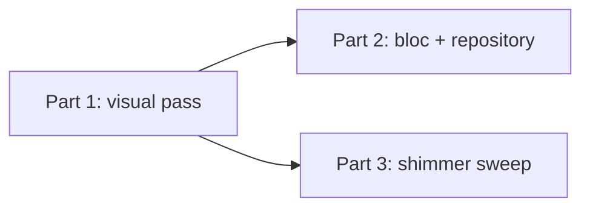

> **Note:** This plan was split into parts. See the -part-N files in this directory.
>
> 1. [Part 1: Explore visual pass](2026-10-13-refactor-explore-screen-polish-part-1-plan.md) (`feat`): shimmer skeletons, thumbnail fade, floating header, shared grid geometry.
> 2. [Part 2: ExploreBloc and repository refactor](2026-10-13-refactor-explore-screen-polish-part-2-plan.md) (`refactor`): single `ExploreState`, `ExploreCursor`, `ExploreRepository`, `bloc_concurrency`. Depends on Part 1.
> 3. [Part 3: App-wide shimmer sweep](2026-10-13-refactor-explore-screen-polish-part-3-plan.md) (`feat`): content-loading spinners become `BeatShimmerFill`. Depends on Part 1, independent of Part 2.

## refactor: explore screen polish and ExploreBloc refactor - Standard

## Overview

Source brainstorm: [2026-10-13-explore-screen-polish-brainstorm-doc.md](../brainstorm/2026-10-13-explore-screen-polish-brainstorm-doc.md).

The work ships as three independently mergeable PRs. Part 1 has to merge first, because Part 2's widget-test updates and Part 3's skeleton widget both build on the scroll-view structure and `FeedGridSkeletonSliver` that Part 1 introduces.

## Decisions made during planning

These are in addition to the brainstorm's decisions.

| Topic | Decision | Source |
|---|---|---|
| Search errors | Add a throwing `SupabaseService.searchExploreVideos`. `searchVideosByTitle` becomes a try/catch wrapper around it, so `ExploreVideoFeedCubit` is unchanged. | User |
| Repository location | `lib/repositories/explore_repository.dart`; tests in `test/repositories/`. | User |
| Header while search is focused | Not pinned. `keyboardDismissBehavior: onDrag` unfocuses on scroll. | User |
| `cacheWidth` on thumbnails | **Deferred.** `PooledVideoSurface` (`lib/widgets/pooled_video_surface.dart:44`) reuses the grid's full-size decoded thumbnail as the feed poster. A resized decode would miss that cache and flash black in the feed. Revisit together with disk caching. | User |
| Plan shape | Three part-N plans, one per PR. | User |
| `SliverFloatingHeader` | Confirmed in the local Flutter 3.47.7 SDK (`packages/flutter/lib/src/widgets/sliver_floating_header.dart`). Part 1's widget tests check pull-to-refresh with it. | SDK check |
| Shimmer tint | Already theme-driven. `BeatShimmerFill` reads `colorScheme`, which is seeded from `electricMagenta` (light) and `cyan` (dark) in `lib/constants/app_themes.dart:142,233`. No colour change is needed. | Research |

## Plan Review Notes

- **Scope:** each part fits one PR. Part 1 has 3 build phases and Part 2 has 2 (data layer, then bloc). Part 3 is a single phase. Parts 2 and 3 touch separate files and can merge in either order after Part 1.
- **Correctness fixes applied to Part 2:**
  - Duplicate searches are skipped only from `success`. Skipping from `loading` could leave the screen stuck after `restartable()` cancels a search.
  - Handlers read `state.filterCatalog` after each `await`, so a concurrent filters load isn't overwritten.
- **Simplifications:**
  - Part 1 no longer patches refresh during a pending debounce. Part 2 deletes that widget code, so it is listed as a known limitation instead.
  - Feed progress isn't merged during an in-flight load-more, which is today's behaviour.
  - One key for the selected chip instead of a key per chip.
  - The repository only wraps the random feed's `error` map. Search exceptions propagate unchanged.
- **Conventions:**
  - `const` events with `List<Object?>` props.
  - `ExploreFeedProgressReceived`, and an `exploreRepository:` constructor parameter.
  - `addError` on failures.
  - An injectable `searchDebounce` for fast bloc tests.
  - Model equality tests.
  - Format-only first commits, because the touched files are unformatted on `main`.
- **Verify commands:** the grep patterns were checked against macOS BSD grep. Diffs are measured against `git merge-base main HEAD`. Format checks cover only the changed `.dart` files.

## Deferred follow-ups (not in any part)

- `cacheWidth` and disk caching (`cached_network_image`), decided together with the feed poster.
- Moving `ExploreVideoFeedCubit` and `ExploreFeedProgress` onto `ExploreRepository` and `ExploreCursor`.
- Video card content (title, sport, real avatar), and restyling the empty and error states.
- Wiring keyboard "Search" (`onSubmitted`) to skip the debounce.
